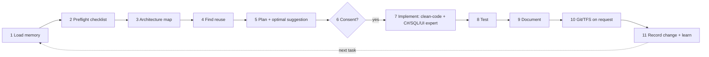

# Dev Companion — reusable skills for Claude Code

A shareable, versioned set of Claude Code skills that make Claude work like a disciplined senior engineer on **any** project: it loads per-project memory, runs a preflight checklist, understands the architecture through a knowledge graph, reuses existing code, asks before editing, writes clean tested code, documents, handles Git/TFS, and learns from corrections.

Packaged as a **plugin marketplace** with five plugins, so teams install only what they need and get updates with one command.

## Install

**Windows (PowerShell)**
```powershell
.\install.ps1                                                   # core + dotnet + ui
.\install.ps1 -Plugins companion-core,companion-dotnet,companion-guard
```
**macOS / Linux / Git Bash**
```bash
./install.sh
```
**Manually inside Claude Code**
```
/plugin marketplace add D:\ClaudeSkills          (or a Git URL — see Sharing)
/plugin install companion-core@dev-companion
/plugin install companion-dotnet@dev-companion
/plugin install companion-ui@dev-companion
```
No plugin support? `.\install.ps1 -Mode Skills` copies the skills into `~/.claude/skills` (or `-Scope Project` for one repo). Hooks aren't installed in that mode.

## Use

| You say / type | What happens |
|---|---|
| `/companion-core:workflow` + your task | Full sequenced workflow (below) |
| "Initialise project memory" | Creates `.claude/knowledge/` in the repo, scans architecture |
| "What uses the Orders table?" | Answers from the knowledge graph, then opens only the relevant files |
| "Remember that we always use Dapper here" | Saved to this project's profile (or global — it asks) |
| "Retro" / "learn from this" | Lessons recorded and promoted across projects |

You don't need to name skills: a prompt hook in `companion-core` matches each request. Requests that change code load the matching expert (for example "add a column to Orders" loads the C# and SQL experts); questions only get an optional hint and Claude decides. Each skill loads once per conversation and is reused after that. Start with `/companion-core:workflow` when you want the full sequence. To change the rules, edit `plugins/companion-core/hooks/route.sh`.

## Workflow sequence


`token-economy` applies throughout. Trivial tasks take the short path (load → consent → implement).

## Skill map

Your 21 requirements are consolidated into 14 skills (overlaps merged to save tokens and avoid conflicting instructions):

| Requirement | Skill | Plugin |
|---|---|---|
| Checklists before starting · User consent before editing · Optimal suggestions | `preflight` | core |
| (sequencing of everything) | `workflow` | core |
| Memory and reuse · Project-wise segregation of knowledge/implementation/preferences · Remember existing changes | `project-memory` | core |
| Architecture awareness · Knowledge graph | `architecture-map` (+ `scan-repo.ps1`) | core |
| Find and remember existing code for reuse · Reuse past changes | `code-reuse` | core |
| Clean and optimal code · Code optimization | `clean-code` | core |
| Testing expert | `testing-expert` | core |
| Documentation | `documentation` | core |
| Git / Team Foundation | `git-tfs` | core |
| Use less tokens | `token-economy` | core |
| Learning and improving | `learning-loop` | core |
| C# expert | `csharp-expert` | dotnet |
| DB/SQL expert | `sql-expert` | dotnet |
| UI/UX expert · Visualization and mockup | `ui-ux-expert` | ui |
| (Razor views, JavaScript/jQuery, popups) | `web-frontend-expert` | ui |
| User consent (hard guarantee) | PreToolUse hook | guard (opt-in) |
| Analyse anything: data, code, maths, patterns, behaviour, decisions | `analyst` (playbooks in `references/`) | analytics (opt-in) |
| Token usage per device · Prompt-style analysis | `usage-analytics` (+ `collect-usage.ps1`, `hub-rows.ps1`, `usage-report.ps1`) | analytics (opt-in) |
| Sync usage from all logged-in devices | `sync-usage` (`/companion-analytics:sync-usage`) | analytics (opt-in) |

## Usage Hub (multi-device usage, opt-in)

Each device publishes its own usage to its owner's private artifact, the **Claude Usage Hub**, through your Claude login. No shared folder, no file copying, no extra cost (artifacts, their database and Remote Control are part of the plan). Rows hold token totals, weighted cost, prompt-style counts and compaction candidates per device, app, project and day; never prompt text.

**Once per device**
1. Install the plugin: `claude plugin marketplace add <this repo or its URL>` (if not added), then `claude plugin install companion-analytics@dev-companion`.
2. In the Claude desktop app: Settings > turn on **Connect new sessions to Remote Control**. Remote Control lets a session on one PC message sessions on your other PCs under the same login.
3. First device of each person only: say "create my usage hub". It publishes your own private hub (usage rows readable and writable only by you). Other devices find it by its title through your login and remember the link in `%LOCALAPPDATA%\companion-analytics\hub.txt`.

**Then, from any device**
- `/companion-analytics:sync-usage`: publishes this device and asks one Remote Control session on each other device to publish too. A device is reached only while it is on, the Claude app is open and a session is connected.
- "publish my usage to the hub": this device only.

## Where knowledge lives (project-wise segregation)

When you initialise project memory ("initialise project memory"), Claude asks where to keep it:

| Choice | Location | Use when |
|---|---|---|
| In the project | `<repo>/.claude/knowledge/` | You want to commit it and share it with the team |
| Local only | `~/.claude/knowledge/projects/<name>/` | Personal use, or the repo must stay untouched |

```
<store>/                           ← per project (in the repo or local)
  INDEX.md  profile.md  architecture.md  graph.md  reuse-catalog.md
  changes.md  decisions.md  lessons.md  profile.local.md (personal)
~/.claude/knowledge/               ← per user, across all projects
  global.md  projects.md  locations.txt (repo -> local store)  projects/<name>/ (local stores)
```
You can switch later: "move project memory to local" or "move project memory into the repo". Router and consent-guard state is always local (`~/.claude/companion-router/`, `~/.claude/companion-guard/`).

The core plugin's SessionStart hook finds the store either way and injects only the real lines of `INDEX.md` and `global.md`, so memory is loaded automatically at minimal token cost.

## Repository layout

```
.claude-plugin/marketplace.json     marketplace catalog (5 plugins)
plugins/
  companion-core/   skills: workflow, preflight, project-memory, architecture-map, code-reuse,
                    clean-code, testing-expert, documentation, git-tfs, token-economy, learning-loop
                    hooks: SessionStart rules + knowledge loader, UserPromptSubmit skill router
  companion-dotnet/ skills: csharp-expert, sql-expert
  companion-ui/     skills: ui-ux-expert, web-frontend-expert
  companion-guard/  hooks: approve the first Edit/Write of each conversation, then allow the rest
  companion-analytics/ skills: analyst, usage-analytics (collect, publish to the Usage Hub), sync-usage
templates/SKILL.template.md         starting point for new skills
tools/validate.ps1                  checks manifests + skills before you share
tools/test-router.sh                router regression test (cases in tools/router-cases.txt)
install.ps1 / install.sh            one-command install
```

## Sharing with your team

1. Push this folder to a Git repo (Azure DevOps, GitHub, internal Git server).
2. Teammates run `.\install.ps1 -Source <git-url>` or `/plugin marketplace add <git-url>`.
3. To make it automatic for a repo, add to that repo's `.claude/settings.json`:
   ```json
   {
     "extraKnownMarketplaces": {
       "dev-companion": { "source": { "source": "git", "url": "<git-url>" } }
     },
     "enabledPlugins": { "companion-core@dev-companion": true, "companion-dotnet@dev-companion": true }
   }
   ```
4. Updates: bump versions, push; users run `/plugin marketplace update dev-companion`.

## Extending

See [CONTRIBUTING.md](CONTRIBUTING.md) — add a skill, a new domain plugin (e.g. `companion-angular`), or upgrade an existing one. Run `tools\validate.ps1` before sharing.
