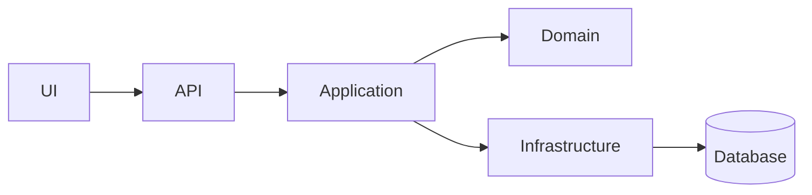

# Architecture

## Overview
<2–4 sentences: what the system does and its overall style (layered, clean, microservices, modular monolith...)>

## Diagram

## Modules / projects
| Module | Responsibility | Depends on |
|--------|----------------|------------|
| | | |

## Key flows
- <e.g. Order placement: OrderController → OrderService → PaymentGateway → OrderRepository>

## Cross-cutting
- Auth:
- Logging:
- Configuration:
- Error handling:

## Last scanned
<YYYY-MM-DD, by architecture-map>
